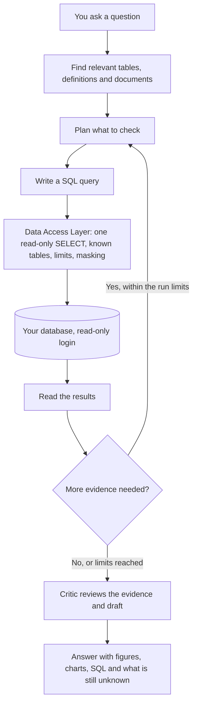

# Charie

### Your data and business analyst. A clearer plan for what to do next.

Ask a question about your business in plain English. Charie investigates your database the way an analyst would, shows every query behind its numbers, and tells you what it could not establish. Every model it calls is a **Meta model**.


[Try it](#try-charie-in-three-ways) · [Use it](#using-charie-step-by-step) · [How it answers](#how-charie-answers) · [Meta models](#how-meta-models-are-used) · [Sample questions](#sample-questions) · [Demo data](#the-demo-data) · [Develop it](#develop-charie-locally) · [Troubleshooting](#troubleshooting)

---

## Why Charie

It's Monday morning. You need to order stock, choose this week's promotion, and work out why sales slowed down. You have the records, but you still don't know where to start.

You could hire a data analyst, or spend hours in reports and dashboards. **Charie is the analyst you can ask directly.** It works out what matters, runs the checks, reviews its own evidence, and explains what the results mean for your next decision.

| | Questions you can bring to Charie |
| --- | --- |
| 📦 **Plan your stock** | “Based on recent sales, what stock should I review before next week?” |
| 🎯 **Explore promotions** | “Which products might suit a promotion, and what have past offers taught us?” |
| 🌱 **Find room to grow** | “Where are we losing sales, and which opportunities should we look into first?” |
| 💰 **Understand the money** | “Sales grew, but did we make more profit?” |
| 📈 **See what changed** | “Which restaurants, products, or days explain the fall?” |
| 💬 **Keep asking** | “Why?”, “What about weekends?”, “Show this as a chart.” in the same chat. |
| 🧾 **Check the answer** | See the figures, charts, and the exact SQL behind every number. |

Charie reads live data from your database when you ask, read-only. It suggests; you decide what to order, offer, or change.

---

## Try Charie in three ways

All three need **only a [Meta Model API key](https://dev.meta.ai/)** with API billing enabled. No other key, password, or database is needed: Charie brings its own database for its records and comes connected to a [hosted demo database](#the-demo-data).

| Way | Best for | Time |
| --- | --- | --- |
| [1. Online demo](#1-online-demo) | A look without installing anything | 1 minute |
| [2. Run the image](#2-run-the-image) | Your own private copy, one command | ~5 minutes |
| [3. Build from this repository](#3-build-from-this-repository) | Seeing everything built from source | ~10 minutes |

> **First start takes about 3–4 minutes.** The app opens within seconds, but Charie first reads the demo database's structure (57 tables). Questions asked before that finishes get "no catalog yet". Later restarts are ready in seconds.

### 1. Online demo

1. Open **https://charie-production.up.railway.app**.
2. Continue to [Using Charie, step by step](#using-charie-step-by-step).

The online demo runs the same image as the other two ways, deployed on Railway.

### 2. Run the image

The image is published as `ghcr.io/50ur48h/charie:latest`. It contains the web app, the API, and Charie's own PostgreSQL database.

1. **Install and start [Docker Desktop](https://docs.docker.com/get-started/get-docker/).** Wait until it says Docker is running.

2. **Open a terminal.** On Windows use **PowerShell** (not Git Bash, which rewrites the `/app/ops` path below). On macOS or Linux use any terminal.

3. **Download the image:**

   ```bash
   docker pull ghcr.io/50ur48h/charie:latest
   ```

4. **Start Charie.** Replace `YOUR_META_KEY` with your key:

   ```bash
   docker run -d --name charie -p 3000:3000 -e META_API_KEY=YOUR_META_KEY -v charie-data:/app/ops ghcr.io/50ur48h/charie:latest
   ```

   `-v charie-data:/app/ops` keeps Charie's data (its database, keys and results) between restarts. If port 3000 is busy on your machine, use `-p 3600:3000` and open port 3600 instead.

5. **Wait until it is ready:**

   ```bash
   docker logs -f charie
   ```

   You will see, in order:

   ```text
   bootstrap: organization 'Charie demo' ready; anyone who signs in joins it
   ✓ Ready in 0ms
   bootstrap: 'Food delivery demo' reachable=True read-only=True
   bootstrap: discovery: Catalog version 1: 57 table(s), 273 column(s), 73 relationship(s).
   bootstrap: profiling: Profiled 273 column(s); 10 look sensitive and default to masked.
   bootstrap: 'Food delivery demo' ready to answer questions
   ```

   Press `Ctrl+C` to stop following the log; Charie keeps running.

6. **Open http://localhost:3000** and continue to [Using Charie, step by step](#using-charie-step-by-step).

**Managing it later**

| To | Run |
| --- | --- |
| Stop Charie | `docker stop charie` |
| Start it again (ready in seconds, data kept) | `docker start charie` |
| Read the log | `docker logs -f charie` |
| Update to the latest image | `docker pull ghcr.io/50ur48h/charie:latest`, `docker rm -f charie`, then step 4 again. Data in `charie-data` is kept. |
| Delete everything and start fresh | `docker rm -f charie` then `docker volume rm charie-data` |

**Deploy the same image on Railway**

1. In a Railway project, choose **New → Docker Image** and enter `ghcr.io/50ur48h/charie:latest`.
2. Under **Variables**, add `META_API_KEY` and nothing else.
3. Under **Settings**: set the health check path to `/api/healthz`, leave the start command empty, and under **Networking** generate a public domain that points to **port 8080** (the port Railway runs the app on).
4. Deploy and watch the **Deploy Logs** for `'Food delivery demo' ready to answer questions`.

Each Railway redeploy starts with a fresh copy of Charie's own database. To keep chats across deploys, add a Railway PostgreSQL service and set `DATABASE_URL` to reference it; Charie creates its own tables and login there.

### 3. Build from this repository

1. **Install [Git](https://git-scm.com/downloads) and [Docker Desktop](https://docs.docker.com/get-started/get-docker/)**, and start Docker Desktop.

2. **Get the code and create your settings file:**

   ```bash
   git clone https://github.com/50ur48h/Charie.git
   cd Charie
   cp .env.example .env
   ```

3. **Add your key.** Open `.env` in a text editor and set:

   ```dotenv
   META_API_KEY=YOUR_META_KEY
   ```

   `.env` is private and ignored by Git. Never commit it.

4. **Build and start:**

   ```bash
   docker compose up --build
   ```

   The first build takes a few minutes. Wait for `'Food delivery demo' ready to answer questions` in the output.

5. **Open http://localhost:3000** and continue below.

Stop with `Ctrl+C` or `docker compose down`. Add `-v` (`docker compose down -v`) to delete Charie's data and start fresh.

---

## Using Charie, step by step

### 1. Sign in

1. On the **Sign in** screen, type any name in **Who are you** (`demo` is filled in) and click **Continue**.
2. In the demo, everyone lands in the **Charie demo** organization as an Admin, already connected to **Food delivery demo**.

> This build uses **development sign-in**: Charie trusts the name you type. It is meant for demos. Do not put private data behind a public link.

**Outside the demo** (an organization nobody has prepared): after signing in you see **Welcome to Charie**. Under **Create an organization**, enter a **Name** and click **Create**. You become its first Admin. Then [connect a database](#4-connect-your-own-database).

### 2. Ask a question

1. On **What would you like to know?**, type a question, or click one under **Try asking**.
2. **Pick the model** in the question box: **Muse Spark 1.3** (default) or **Muse Wonder 1.0**. The line under the box confirms it: *Answered by Meta Muse Spark 1.3 (muse-spark-1.3) through the Meta Model API.*
3. Press **Enter**.
4. Click **Thinking…** to watch the investigation live. Each step appears as it happens, including every Meta model call, marked **Meta**:

   > **Muse Spark 1.3 wrote the query** `Meta`
   > Live call to the Meta Model API (muse-spark-1.3) · 2.5 s · 6,752 tokens in, 191 out.

   When it finishes, the pill reads **Thought for N seconds** with chips such as **18 steps · 4 Meta model calls · 1 query**.

### 3. Read and check the answer

| Part of the answer | What it shows |
| --- | --- |
| **Headline and KPI cards** | The answer first, with key figures as cards (value, change, comparison). |
| **Tables and charts** | Charts can be switched with **Chart / Table**, opened **Full screen**, or saved with **Download as image** / **Download as CSV**. |
| **N things to know** | Limits Charie found: numbers it calculated rather than read, tables it did not use, a period the data does not cover. |
| **How I worked this out** | **Method** (one line on how it was reached), **Definitions** applied, **Findings** with confidence, and **Cost**. **Show the query behind this** opens the exact SQL and the rows it returned. |
| **Answered · backed by N queries** | How the run ended and how many real queries support it. |
| **Copy**, 👍 / 👎 | Copy the answer, or rate it. |
| **This is wrong** | Describe the problem and click **Send correction**; Charie takes another look with your note. |
| **You might also ask** | One-click follow-ups such as **Show this as a chart**, **What is driving this?**, **How does this compare with the period before?** |

Keep asking in the same chat: follow-ups build on the previous answer.

### 4. Connect your own database

Only Admins can do this. Charie needs a **dedicated read-only login**; it refuses any login that can write.

1. Click **Settings** (bottom of the sidebar), then **Data sources** (*Read-only databases*).
2. Under **Register a database**, fill in:

   | Field | Example |
   | --- | --- |
   | **Name** | `Sales warehouse` |
   | **Engine** | **PostgreSQL** or **SQL Server** |
   | **Host** | `db.example.com` |
   | **Port** | `5432` (PostgreSQL) or `1433` (SQL Server) |
   | **Database** | `sales` |
   | **Username** / **Password** | the read-only login |
   | **Encryption** | **Deployment policy**, or `require` / `verify-ca` / `verify-full` |

3. Click **Register**.
4. On the new source, click **Test connection**. Charie reports **Reachable**, **Read-only**, **Encryption** and **Server**, and the badge becomes **read-only verified**. If it says **not usable**, check the details: **Rotate password** changes the password; for anything else, **Remove** it and register again.
5. Click **Refresh catalog**. Charie reads the tables, columns and relationships.
6. Click **Profile columns** (optional, recommended). Charie samples values, notes empty and distinct counts, and flags sensitive-looking columns, which are masked by default.
7. Click **Answer questions from this** to make it the database new chats use.

The database must be reachable from where Charie runs. Inside Docker, `localhost` means the container itself, not your computer; use `host.docker.internal` for a database on your own machine.

### 5. Optional: tell Charie more

| Where | What it does |
| --- | --- |
| **Data sources → Catalog** | Browse tables (**Find a table**), see each column's **Role**, **Sample** and **Policy**. Admins set each column to **allow**, **mask** or **deny**; masked values never reach the model unmasked, denied columns cannot be queried. |
| **Data sources → Definitions** | What your metrics mean, so answers use your rules. **Import from a metric table** or **Write one by hand** (name, what it means, formula, *Answers must say*). Add **Required filters** and choose **Accept and enforce**; Charie then applies them to the SQL it writes. |
| **Questions for you** (sidebar, Admins) | Imported definitions waiting for your review. |
| **Knowledge** | Upload business documents (`.md`, `.txt`, or a PDF with a text layer) via **Add a document**. Charie consults them when a question needs context the tables cannot give. |
| **Settings → Members** | **Invite someone** by email as reader, contributor or admin, and copy the **Invitation link**. |
| **Settings** | **Show cost on answers** (Spend), **Appearance** (palette, light or dark), and **Archived chats** (**Restore**). |

---

## How Charie answers

For each question Charie runs an investigation, not a single prompt:



**It investigates in steps.** One query may establish the overall change, another compare restaurants, a third check the daily pattern. The next step depends on what the last result showed. Each run is capped: a set number of iterations, queries, model calls, time, and a spending ceiling per question.

**Safety: it cannot change your data or see what it should not.**

- Charie only connects with logins it has **proven read-only**; it tests that before use.
- Every query passes through the **Data Access Layer**: a single `SELECT`, only tables and columns in the catalog, with row limits and timeouts. A query that breaks a rule is rejected before it reaches your database, and the model is told why so it can correct itself.
- **Sensitive columns are masked** before results are stored or shown to the model. Admins decide per column (**allow / mask / deny**).
- Saved database passwords are **encrypted**, and organizations are separated by row-level security in Charie's own database.
- The model is never trusted with permissions: these checks are code, not instructions.

**Honesty: it says what it does not know.**

- A **critic** step reviews every draft. Code checks that cited queries succeeded and that reported numbers appear in the results; a Meta model reviews for unsupported claims and conflicting findings.
- What it finds becomes **things to know** beside the answer: numbers it calculated rather than read, tables it did not use, a period the data does not cover.
- If only part of a question can be answered, the answer says which part, and the badge reads **partly answered** rather than **answered**.

**Inspectable: you can check every number.** **How I worked this out** lists the method, the definitions applied, each finding with its confidence, and **Show the query behind this** for the exact SQL and rows. **Thinking** keeps the full trace of the investigation, including every Meta model call.

**Your choice of model.** Pick **Muse Spark** or **Muse Wonder** per question. The choice is saved with the run and used for every step of it.

**Conversation.** Follow-ups continue the same investigation thread, and **This is wrong** sends your correction for another look.

These checks catch many mistakes; they do not guarantee every conclusion. Charie shows its evidence and its gaps so the answer can be questioned.

---

## How Meta models are used

Every model Charie calls at runtime is a Meta model, through the [Meta Model API](https://dev.meta.ai/). The code has no other model provider and no embedding model: tables and documents are found by their wording.

| Model | API id | Where it is used |
| --- | --- | --- |
| **Muse Spark 1.3** | `muse-spark-1.3` | The default for every step of every question. |
| **Muse Wonder 1.0** | `muse-wonder-1.0` | Optional, chosen per question in the question box. Meta lists it as a preview, priced at about four times Muse Spark. |

Each question is answered by several Meta model calls, each with one job:

| Step | Role | What the model does |
| --- | --- | --- |
| **Understand** | `intake` | Work out the question, the time period and the measures involved. |
| **Plan** | `plan` | Decide what to check next, or that there is enough to answer. |
| **Query** | `sql` | Write the SQL from the catalog, definitions and rules Charie supplies. |
| **Reflect** | `observe` | Read the results and decide what they mean. |
| **Review** | `critic` | Look for gaps, conflicting findings and claims beyond the evidence. |
| **Explain** | `compose` | Write the answer, its key figures and its chart. |

**Where you can see them:** live in **Thinking** (one row per call, marked **Meta**, with model id, seconds and tokens), counted on every finished answer (**N Meta model calls**), named under the question box, and recorded in Charie's usage ledger with tokens and cost.

The calls go from Charie's API to `https://api.meta.ai/v1` with your `META_API_KEY`. Relevant schema details, definitions, document excerpts and (masked) query results are included in those requests. On Muse Spark a question typically costs from a few US cents to about 20 cents, depending on how many steps it takes; every question is capped at US$5.

---

## Sample questions

These work against the demo data. Paste them as they are, then try your own.

**Start here**

- How did we do in December 2025?
- How did November 2025 compare with November 2024?
- Which 3 cities had the most orders in 2025?
- Which 3 cuisines have the most restaurants?

**Charts**

- Draw a line chart of monthly sales in 2025, with one line for each of the top 3 restaurants by sales.
- Show monthly orders for 2025 as a line chart.
- Compare sales by cuisine in 2025 as a bar chart.

**Dig deeper**

- Which restaurants lost sales in 2025, and what changed for them?
- Do customers who used a coupon order again?
- Which restaurants have the lowest review ratings, and is it affecting their orders?
- How long do deliveries take, and which cities are slowest?
- Which ingredients are wasted most, and what does it cost?
- Which outlets made the most estimated profit in 2025?

**Tips**

- For a chart, say **"draw a line chart"** or **"as a bar chart"**, and for several lines say **"one line for each …"**.
- Ask for a **short answer** when you only need the main point.
- Try the same question on **Muse Wonder** and compare.
- Follow up with **"Why?"**, **"Show this as a chart"**, or **"What about weekends?"**.
- Each answer is written fresh, so wording and depth vary between runs. Use **How I worked this out** to check any number.

---

## The demo data

The demo connects to a hosted PostgreSQL database on [Neon](https://neon.tech) built from the open **[Food Delivery sample database](https://databasesample.com/datasets/food-delivery-sample-database)** from databasesample.com. All of it is synthetic.

| Area | Tables (schema `public`) | Rows |
| --- | --- | --- |
| Orders | `orders` (Jan 2024 – Dec 2025), `order_items` | 400,000 orders, 1,000,000 order items |
| Customers | `users`, `addresses`, `payment_methods`, `shopping_carts` | 40,000 customers |
| Restaurants and menus | `restaurants`, `menu_items`, `menu_categories`, `cuisine_types`, `modifier_groups` | 60 restaurants, 1,800 menu items, 12 cuisines |
| Delivery | `deliveries`, `couriers`, `courier_locations`, `courier_reviews` | 400,000 deliveries, 2,000 couriers |
| Feedback and offers | `reviews`, `coupons`, `support_tickets` | 100,000 reviews |
| Places | `cities`, `states`, `countries` | 10 cities |

A second schema, `charie`, adds restaurant operations generated to match those orders: recipes and ingredients, daily inventory, suppliers and purchase orders, goods receipts, waste events, labour, operating expenses, and views such as `v_daily_outlet_sales` and `v_monthly_outlet_profit_estimate`.

Charie connects with a **read-only login that is published on purpose** in [`apps/api/src/charie/ops/bootstrap.py`](apps/api/src/charie/ops/bootstrap.py), so the demo works with nothing but a Meta key. It verifies the login cannot write before using it. Columns that look personal, such as emails and account numbers, are masked by default.

---

## Develop Charie locally

For working on Charie's code: the web app and API run separately with hot reload, against a development Postgres.

### Before you start

- [Docker Desktop](https://docs.docker.com/get-started/get-docker/), running.
- [Git](https://git-scm.com/downloads) and [uv](https://docs.astral.sh/uv/getting-started/installation/).
- [Node.js 22](https://nodejs.org/en/download) and [pnpm 10.30.3](https://pnpm.io/installation).
- GNU Make. On Windows run `winget install ezwinports.make` in PowerShell, then use **Git Bash** for the commands below.
- A [Meta Model API key](https://dev.meta.ai/) with billing enabled.

### 1. Get the project

```bash
git clone https://github.com/50ur48h/Charie.git
cd Charie
uv python install 3.12
make install
make env
```

`make env` creates `.env` from [.env.example](.env.example), which documents every setting.

### 2. Add your Meta key and the key for saved connections

In `.env`, set `META_API_KEY=` to your key. Then run:

```bash
make secrets.key
```

Copy the whole `LOCAL_SECRETS_KEY=...` line it prints into `.env`. Keep it unchanged afterwards: it encrypts saved database passwords.

The model settings in `.env.example` (Muse Spark by default, Muse Wonder selectable, US$5 per-question cap) need no change.

### 3. Start the stack

```bash
make up
make db.setup
```

`make up` starts the web app (port 3000), the API (port 8000) and the development database; `make db.setup` runs migrations and creates the restricted `charie_app` login the API uses.

Open http://localhost:3000, sign in with any name, and **create an organization**.

### 4. Connect a database

Follow [Connect your own database](#4-connect-your-own-database). The development stack does not connect the demo database automatically; to use it, register it with the values in [`apps/api/src/charie/ops/bootstrap.py`](apps/api/src/charie/ops/bootstrap.py).

### Useful commands

| Command | What it does |
| --- | --- |
| `make help` | Every development and test command |
| `make down` | Stop the stack, keeping data |
| `make logs` / `make ps` | Logs and status |
| `make lint`, `make typecheck`, `make test` | Checks for both apps |

After changing `.env`, recreate the API so it reads the new values:

```bash
docker compose --env-file .env -f ops/docker-compose.yml up -d api
```

---

## Troubleshooting

| If this happens… | Try this |
| --- | --- |
| **"no catalog yet"**, or a chat shows **no database chosen** | Charie was still reading the demo database. Wait for `'Food delivery demo' ready to answer questions` in the log, then start a **New chat**. |
| **The page does not open** | Check Docker is running and `docker logs charie` (or `make logs`). If port 3000 is taken, run with `-p 3600:3000` and open port 3600. |
| **Railway shows 502 Bad Gateway** | Under **Settings → Networking**, point the public domain to port **8080**. |
| **Questions fail straight away** | Check `META_API_KEY`, that API billing is enabled, and that your account can use `muse-spark-1.3`. The log shows the provider's error. |
| **A database will not connect** | Check host, port, encryption and the read-only login. From inside Docker, use `host.docker.internal` instead of `localhost`. |
| **A table shows as one long line** | Ask again; the model occasionally formats a table badly. |

---

## For developers

| Where | What |
| --- | --- |
| `apps/web` | Next.js app: chat, Thinking panel, charts, settings |
| `apps/api` | FastAPI app: agent loop, critic, composer, Data Access Layer, connectors, Meta Model API client |
| `apps/api/src/charie/db/alembic` | Database migrations for Charie's own database |
| `ops/` | Development Compose stack, seed data for tests, scripts |
| `Dockerfile`, `ops/docker/start.sh` | The single image and its start-up |
| [`AGENTS.md`](AGENTS.md) | Working agreement and project rules |
| [`CHANGELOG.md`](CHANGELOG.md) | What changed |

**License:** No license has been selected yet. All rights reserved.
