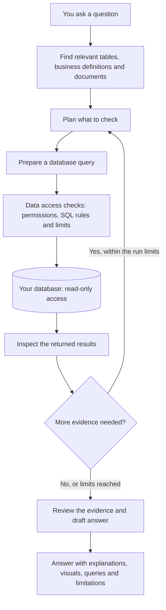

# Charie

### Your data and business analyst. A clearer plan for what to do next.

[What you can do](#what-you-can-do) · [How it works](#how-charie-works) · [Meta models](#how-meta-models-are-used) · [Try it in one command](#try-charie-in-one-command) · [Run it locally](#run-charie-locally)

It's Monday morning. You need to order stock, choose this week's promotion, and work out why sales slowed down. You have the records, but you still don't know where to start.

You could hire a data analyst. Or spend hours digging through your database, reports, and BI dashboards, trying to piece together an answer. Even then, you might have more charts than clarity.

**Meet Charie, your data and business analyst.** Ask a question in everyday English, and it investigates your data the way an analyst would: work out what matters, look for patterns, check the findings, and explain what they mean for your next decision.

> “What should I focus on this week to grow sales without buying stock I won't sell?”

It brings together your sales history, stock records, and knowledge base—the documents and business rules you share. With that information available, Charie can help you explore which products need attention, where a promotion might help, and what to check before placing your next order. You can ask a follow-up, compare options, and see the evidence behind the suggestions.

That could mean reviewing stock for a product that keeps selling out, considering an offer for a quiet weekday, or checking whether a popular discount brings customers back. The aim is to help you decide what to do next with the information your business already has.

**One shop, a growing company, or a team managing hundreds of locations:** you deserve a clear view of what is working and where to focus. And it goes beyond running a business—any team with connected data can use Charie to investigate questions and make better-informed plans.

It reads live data from your connected database when you ask. New records are available for the next investigation as they reach that database, so freshness follows your source. Suggestions depend on the information available; Charie shows the supporting work and what is still missing.

## What you can do

| | Questions you can bring to Charie |
| --- | --- |
| 📦 **Plan your stock** | “Based on recent sales, what stock should I review before next week?” |
| 🎯 **Explore promotions** | “Which products might suit a promotion, and what have past offers taught us?” |
| 🌱 **Find room to grow** | “Where are we losing sales, and which opportunities should we look into first?” |
| 👥 **Bring customers back** | “Do people return after their first offer, or do they only buy with a discount?” |
| 💰 **Understand the money** | “Sales grew, but did we make more profit?” |
| 📈 **See what changed** | “Which stores, products, or days explain the fall?” |
| 📖 **Use what your team knows** | Share business rules, product information, and past campaign notes so the analysis has context. |
| 💬 **Keep asking** | “Why?”, “What about weekends?”, “Show me the comparison.” Continue in the same chat. |
| 🧾 **Check the answer** | See the figures, charts, and queries behind the explanation. |

Each question needs the relevant data. Stock planning may need stock levels and supplier lead times; profit needs cost data; promotion ideas are stronger with past campaign results and business notes. Charie helps you assess the options. You choose what to order, offer, or change.

Answers can mix a short summary, key figures, tables, and charts. Ask for a **short answer** when you only need the main point.

## How Charie works

Before the first question, Charie reads the database structure: tables, columns, and relationships. Column profiling adds information about the values they contain. Business definitions and uploaded documents add the meaning that table names alone cannot explain.

For each question, Charie works through an investigation:



**It investigates in steps.** One query may establish the overall change; another may compare stores; a third may check the daily pattern. The next step depends on what the earlier results show. The controller limits queries, model calls, time, and spending so an investigation cannot continue indefinitely.

**It checks access before running SQL.** Every customer-data query passes through the Data Access Layer (DAL). This code checks SQL against the catalog and access policy, applies query limits and timeouts, and masks protected values before results are stored or shown to the model. Database credentials are checked for read-only access. The model cannot grant itself permissions or bypass this route.

**It reviews the evidence before presenting it.** Code checks things such as whether cited queries succeeded and whether reported numbers appear in the results. A separate model review looks for unsupported assumptions, conflicting findings, and missing evidence. Some findings become visible warnings rather than blocking the answer.

**It keeps the work inspectable.** The API stores the run, query references, and progress events. The browser shows progress while the investigation runs, then renders the answer with its evidence. If the answer is incomplete, the product can show what remains unanswered.

These checks help catch mistakes; they do not guarantee that every query or business conclusion is correct. Charie shows gaps and warnings so a polished report can still be questioned.

## How Meta models are used

Every model Charie calls at runtime is a Meta model, through the [Meta Model API](https://dev.meta.ai/). The code has no other model provider and no embedding model: tables and documents are searched by their wording.

| Model | API id | Where it is used |
| --- | --- | --- |
| **Muse Spark 1.3** | `muse-spark-1.3` | The default for every step of every question. |
| **Muse Wonder 1.0** | `muse-wonder-1.0` | Optional, picked per question in the box where you type. Meta lists it as a preview, priced at about four times Muse Spark. |

Each question is investigated in separate model calls, one job each:

| Step | Role | What the model does |
| --- | --- | --- |
| **Understand** | `intake` | Work out the question, the time period, and the business measures involved. |
| **Plan** | `plan` | Decide which checks would help answer it. |
| **Query** | `sql` | Write the SQL, using the tables and business rules Charie supplies. |
| **Reflect** | `observe` | Read the results and decide what needs checking next. |
| **Review** | `critic` | Look for gaps, conflicting findings, and conclusions that go beyond the evidence. |
| **Explain** | `compose` | Turn the findings into a clear answer with visuals. |

**Seeing the calls happen.** Open **Thinking** above an answer while it runs. Every Meta model call appears as its own step, marked **Meta**, as soon as it returns, for example:

> **Muse Spark planned the checks** `Meta`
> Live call to the Meta Model API (muse-spark-1.3) · 2.4 s · 3,120 tokens in, 410 out.

The finished answer counts its Meta model calls, the text under the question box names the model that will answer, and every call is also written to the usage ledger with its model, tokens, cost and time.

The calls run from Charie's API container to `https://api.meta.ai/v1` with your `META_API_KEY`. Charie controls the database connection, permissions, query checks, and run limits. Relevant schema details, document excerpts, and query results may be included in the requests.

## Try Charie in one command

Everything needed for the demo is in this repository. You need [Docker Desktop](https://docs.docker.com/get-started/get-docker/) and a [Meta Model API key](https://dev.meta.ai/) with API billing enabled. No other key or password is needed.

1. Get the project and add your key:

   ```bash
   git clone https://github.com/50ur48h/Charie.git
   cd Charie
   cp .env.example .env
   ```

   Open `.env` and set `META_API_KEY=` to your key. Never commit `.env`.

2. Start it:

   ```bash
   docker compose up --build
   ```

   The first start builds the image, sets up Charie's own database and connects the demo database, which takes a few minutes. It is ready when the log shows `Ready`.

3. Open http://localhost:3000, sign in as **demo** (already filled in) and ask a question, for example:

   > Which restaurants grew fastest in 2025, and what drove it?

**The demo data** is a hosted PostgreSQL database on Neon with synthetic food-delivery data: restaurants, menus, orders, deliveries and suppliers. `docker-compose.yml` connects to it with a read-only login that is published on purpose; Charie checks that it cannot write before using it.

Stop with `docker compose down`. Add `-v` to also delete Charie's local data and start fresh.

## Run Charie locally

You will start the app, connect your PostgreSQL server with a read-only login, and ask your first question. No demo database or seeding is needed.

### Before you start

Install these once:

- [Docker Desktop](https://docs.docker.com/get-started/get-docker/) — start it before running the app.
- [Git](https://git-scm.com/downloads) and [uv](https://docs.astral.sh/uv/getting-started/installation/).
- [Node.js 22](https://nodejs.org/en/download) and [pnpm 10.30.3](https://pnpm.io/installation).
- GNU Make. On Windows, run `winget install ezwinports.make` in PowerShell, then open a new **Git Bash** window for the commands below. On macOS or Linux, use a terminal with Make installed.

Create a [Meta Model API key](https://dev.meta.ai/) and enable API billing. Model calls use your Meta account and are billed by usage.

### 1. Get the project

Copy this into your terminal:

```bash
git clone https://github.com/50ur48h/Charie.git
cd Charie
uv python install 3.12
make install
make env
```

You now have the project, its dependencies, and a local settings file called `.env`.

### 2. Add your Meta key

Open `.env` in a text editor. Replace the matching settings with the block below, adding any that are missing. Replace `paste_your_meta_key_here` with your key:

```dotenv
META_API_KEY=paste_your_meta_key_here
LLM_PROVIDERS=meta
LLM_MODELS={"meta":{"small":"muse-spark-1.3","mid":"muse-spark-1.3","strong":"muse-spark-1.3"}}
LLM_SELECTABLE_MODELS=muse-spark-1.3,muse-wonder-1.0
LLM_PRICES={"muse-spark-1.3":{"input":1.25,"output":4.25},"muse-wonder-1.0":{"input":4.00,"output":20.00}}
META_REASONING_EFFORT=minimal
LLM_RUN_COST_LIMIT_USD=5.00
```

This uses Muse Spark for every analysis step, lets you switch a question to Muse Wonder, sets a per-question spending limit, and uses wording-based search to find relevant tables and documents. The price entries are USD per million tokens; check [Meta's pricing](https://dev.meta.ai/docs/pricing-rate-limits) if you change the model.

Leave the other settings as they are for this first setup. Keep `.env` private.

### 3. Create the key that protects saved connections

Run:

```bash
make secrets.key
```

It prints a line beginning with `LOCAL_SECRETS_KEY=`. Copy the **whole line** into `.env`, replacing the empty line with that name. Save the file.

Keep this key unchanged after saving database connections. Charie uses it to protect their passwords.

### 4. Start Charie

```bash
make up
make db.setup
```

The first start may take a few minutes while Docker downloads and builds the services. These commands start the app and prepare its own platform database. Your business data stays on your PostgreSQL server.

Open **[http://localhost:3000](http://localhost:3000)**. You should see the sign-in screen. Enter a name, continue, and create an organization.

### 5. Connect your PostgreSQL server

Open **Settings → Data sources → Register a database**. Enter your server's host,
port, database name, and a dedicated read-only username and password. Use the
appropriate TLS settings for that server. The API container must be able to
reach it; localhost inside that container refers to the API itself.

Run **Test connection**, **Refresh catalog**, then **Profile columns**. Choose
**Answer questions from this** to select the source for your organization.

### 6. Ask your first question

> “How are sales changing, and where should I focus first?”

Use a question relevant to your data. Open **How I worked this out** to inspect
the evidence and ask follow-up questions in the same chat.

### Need help?

| If this happens… | Try this |
| --- | --- |
| The app will not open | Check that Docker Desktop is running. Run `make ps` to see service status, or `make logs` to read the logs. |
| Questions fail | Check your Meta key, billing, and access to `muse-spark-1.3`. The API logs can show the failure. |
| The database will not connect | Check the server hostname, port, TLS settings and read-only credentials. Verify the server is reachable from the API container. |
| You changed `.env` but nothing changed | Recreate the API with the command below, then reload the browser. A restart alone keeps the old environment values. |
| A port is already in use | See the port and environment settings in [.env.example](.env.example) and the local setup steps above. |

```bash
docker compose --env-file .env -f ops/docker-compose.yml up -d api
```

Run `make down` to stop the app and keep your saved data. Run `make up` to start it again.

### Ready to use your own data?

Register your PostgreSQL or Microsoft SQL Server database through the same screen, using a dedicated read-only login. It needs to be reachable from the API container. Then test the connection, refresh the catalog, and profile the columns.

Add your team's definitions under **Settings → Definitions** and business documents under **Knowledge**. This helps Charie understand the meaning behind your numbers.

## Deploy on Railway

Charie ships as one image, `ghcr.io/50ur48h/charie:latest`, published by the **publish-images** workflow (Actions → publish-images → Run workflow). Each run also tags the commit, for example `charie:029dd2e`.

The image runs the web app on `$PORT` and the API inside the same container. The browser reaches the API at `/api` on the same address, so there is no separate API URL to configure.

1. **Database.** Add a PostgreSQL service with the `pgvector` extension available.
2. **Service.** Create a service from the image. Remove any custom start command so the image's own start script runs. Set the health check path to `/api/healthz`.
3. **Variables.** Set these on the service:
   - `APP_DATABASE_URL`: `postgresql+asyncpg://charie_app:<app password>@<host>:<port>/<db>`
   - `LOCAL_SECRETS_KEY`: a key from `make secrets.key`
   - `META_API_KEY` and the `LLM_*` settings from `.env.example`
4. **Volume.** Mount a volume at `/app/ops` so saved connections (`/app/ops/.secrets`) and query results (`/app/ops/artifacts`) survive redeploys.
5. **First deploy only.** Open a shell on the service and run, with the owner connection:

   ```bash
   DATABASE_URL=postgresql+asyncpg://<owner>:<password>@<host>:<port>/<db> \
   APP_DB_PASSWORD=<app password> \
   sh -c 'alembic upgrade head && python -m charie.db.grant_app_login'
   ```

   Run `alembic upgrade head` again after upgrading to an image with new migrations.

**Sign-in.** The image uses development sign-in: anyone who can open the URL can sign in by typing a name. Keep the URL private until real sign-in is added.

## For developers

- [Architecture](docs/architecture.md) — system design and data boundaries.
- [Working agreement](AGENTS.md) — project rules and environment troubleshooting.

The interface lives in `apps/web`; the API and analysis engine live in `apps/api`. `make help` lists the development and test commands.

**License:** No license has been selected yet. All rights reserved.
